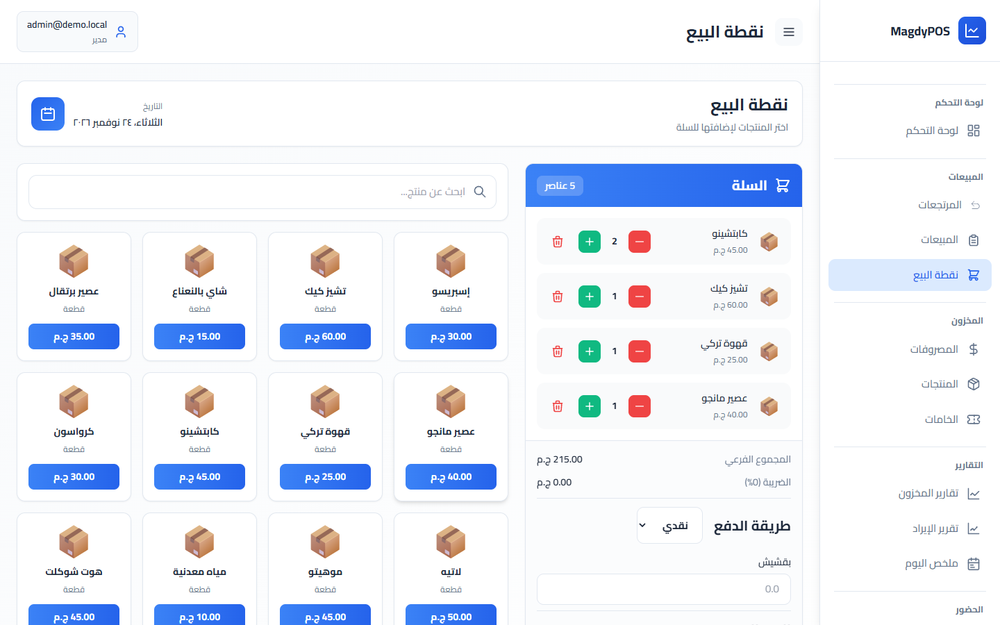

<div align="center">

# 🧾 MagdyPOS

**A free, open-source Point of Sale & inventory system for cafés, restaurants and small shops — Arabic-first, runs offline on one Windows PC.**

**نظام نقاط بيع ومخزون مجاني ومفتوح المصدر للكافيهات والمطاعم والمحلات الصغيرة — بالعربي، ويعمل بدون إنترنت على جهاز واحد.**

[](https://github.com/ahmedmagdy492/MagdyPOS/actions/workflows/build.yml)
[](https://github.com/ahmedmagdy492/MagdyPOS/releases)
[](LICENSE)
[](https://dotnet.microsoft.com/)
[](https://github.com/ahmedmagdy492/MagdyPOS/stargazers)

[**🌐 Website**](https://magdypos.github.io/) · [**⬇️ Download**](https://github.com/ahmedmagdy492/MagdyPOS/releases/latest) · [**🐞 Report a bug**](https://github.com/ahmedmagdy492/MagdyPOS/issues/new/choose) · [**العربية**](#-بالعربي)

</div>

<!--
  TIP: add screenshots/GIF here — it's the #1 thing that makes people star a repo.
  Put images in docs/screenshots/ and uncomment:
  <p align="center"></p>
-->

## ✨ Features

| | |
|---|---|
| 🛒 **Fast sales screen** | Product grid, cart, tips, and order states |
| 📦 **Inventory with recipes** | Products are built from raw materials — stock is deducted automatically on every sale |
| 📏 **Units of measure** | Grams, liters, pieces… define your own |
| ↩️ **Returns** | Record returns against orders, tracked per user |
| 💸 **Expenses** | Track daily expenses next to revenue |
| 🕒 **Staff attendance** | Check-in / check-out, weekly attendance view |
| 📊 **Reports** | Revenue, daily summary (with export), stock levels, low-stock alerts, stock movements |
| 👥 **Users & roles** | Admin and Sales roles with permission claims |
| 📱 **Mobile API** | JWT-secured REST API (`/api/mobile/*`) for a companion mobile app |
| 💾 **Zero setup** | Single `.exe`, SQLite database created on first run, guided first-admin setup |
| 🔌 **USB backup** | Small native tool that copies the database to a USB drive |

## 🚀 Quick start

### Option 1 — Download (no install needed)

1. Grab the latest `MagdyPOS-*-win-x64.zip` from [**Releases**](https://github.com/ahmedmagdy492/MagdyPOS/releases/latest).
2. Unzip and double-click **`Start.bat`**.
3. Your browser opens at `http://localhost:5000` — create your admin account and start selling.

### Option 2 — Run from source

```bash
git clone https://github.com/ahmedmagdy492/MagdyPOS.git
cd MagdyPOS
dotnet run
```

Requires the [.NET 8 SDK](https://dotnet.microsoft.com/download/dotnet/8.0).

### Build your own single-file exe

```bash
dotnet publish -c Release -r win-x64 --self-contained true -p:PublishSingleFile=true
```

> ⚠️ Before using with real data, change `Jwt:Key` and the seed passwords in `appsettings.json`. See [SECURITY.md](SECURITY.md).

## 🧱 Tech stack

- **ASP.NET Core 8 MVC** + Razor views (RTL Arabic UI)
- **Entity Framework Core** + **SQLite** (auto-migrated)
- **ASP.NET Core Identity** (cookies for web, JWT for mobile)
- **Chart.js** for reports
- **C++ / Win32** USB backup utility (`updater/`)

## 📱 Mobile API

All endpoints live under `/api/mobile` and use a Bearer token from `POST /api/mobile/auth/login`.

| Method | Endpoint | |
|---|---|---|
| `POST` | `/auth/login` | Get a JWT |
| `GET` | `/dashboard` | Today's KPIs |
| `GET/POST` | `/products`, `/units`, `/materials`, `/expenses` | List / create |
| `GET/POST` | `/orders` | List / submit an order |
| `GET` | `/reports/summary` | Sales summary |
| `GET/POST` | `/attendance/me`, `/attendance/checkout` | Attendance |

## 🗺️ Roadmap

- [ ] English UI / multi-language support
- [ ] Thermal receipt printing
- [ ] Barcode scanner support
- [ ] Docker image
- [ ] Companion mobile app
- [ ] Automated tests

Have an idea? [Open a feature request](https://github.com/ahmedmagdy492/MagdyPOS/issues/new/choose).

## 🤝 Contributing

Contributions of all sizes are welcome — see [CONTRIBUTING.md](CONTRIBUTING.md).

## ⭐ Support the project

If MagdyPOS helps you or your business, **give it a star** — it helps other shop owners find it!

[](https://star-history.com/#ahmedmagdy492/MagdyPOS&Date)

---

<div dir="rtl">

## 🇪🇬 بالعربي

هذا الكود مبني بأدوات الذكاء الاصطناعي وهو متاح لأي استخدام لوجه الله لمن يريد الاستفادة منه.

### المميزات

- 🛒 شاشة بيع سريعة مع سلة وإكراميات وحالات للطلبات
- 📦 مخزون بالمكونات (وصفات): خصم المواد الخام تلقائيًا مع كل عملية بيع
- ↩️ المرتجعات، 💸 المصروفات، 🕒 حضور وانصراف الموظفين
- 📊 تقارير: الإيرادات، الملخص اليومي، المخزون، حركة المخزون
- 👥 مستخدمين وصلاحيات (مدير / مبيعات)
- 📱 واجهة API للموبايل
- 💾 ملف تشغيل واحد بدون تثبيت، وقاعدة بيانات تُنشأ تلقائيًا

### طريقة التشغيل

1. حمّل أحدث نسخة من صفحة [الإصدارات](https://github.com/ahmedmagdy492/MagdyPOS/releases/latest).
2. فك الضغط وشغّل **`Start.bat`**.
3. سيفتح المتصفح على `http://localhost:5000` — أنشئ حساب المدير وابدأ البيع.

لبناء الكود بنفسك:

</div>

```bash
dotnet publish -c Release -r win-x64 --self-contained true -p:PublishSingleFile=true
```

<div dir="rtl">

للمميزات والتفاصيل: [magdypos.github.io](https://magdypos.github.io/)

⭐ لو البرنامج أفادك، ادعمنا بنجمة على GitHub!

</div>

## 📄 License

[MIT](LICENSE) © Ahmed Magdy
